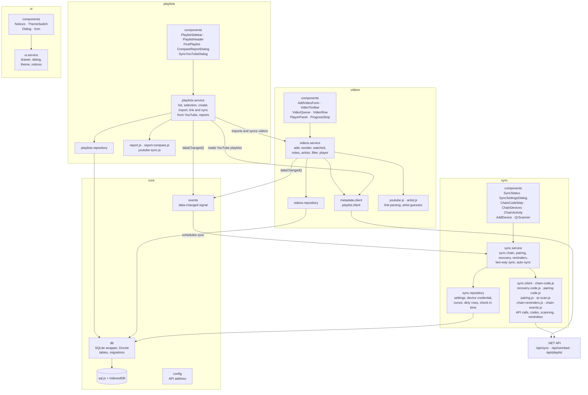
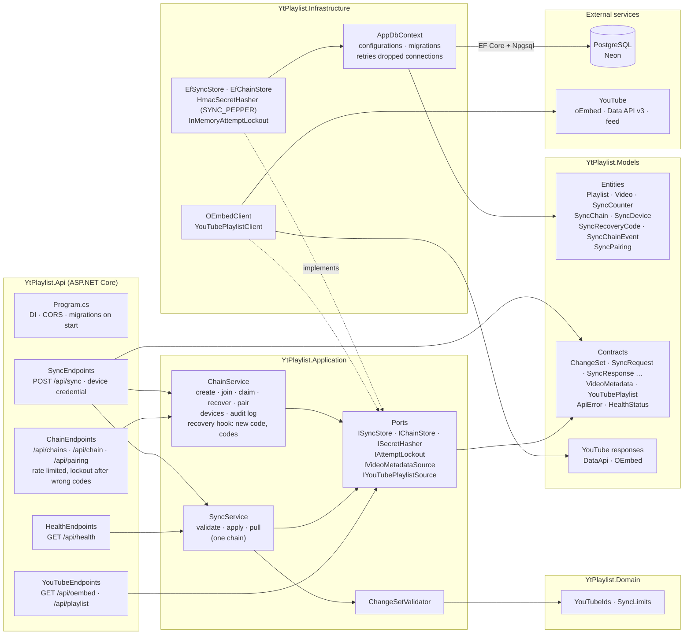
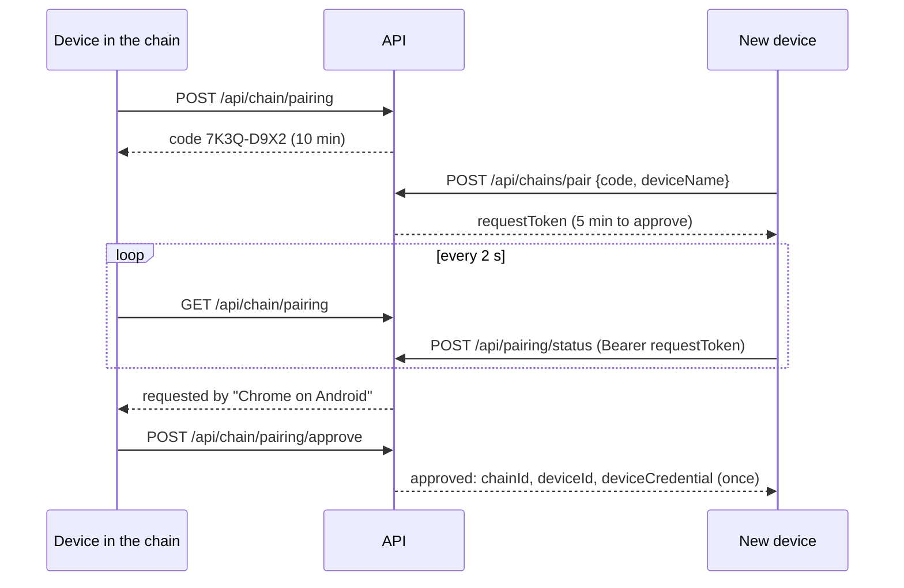
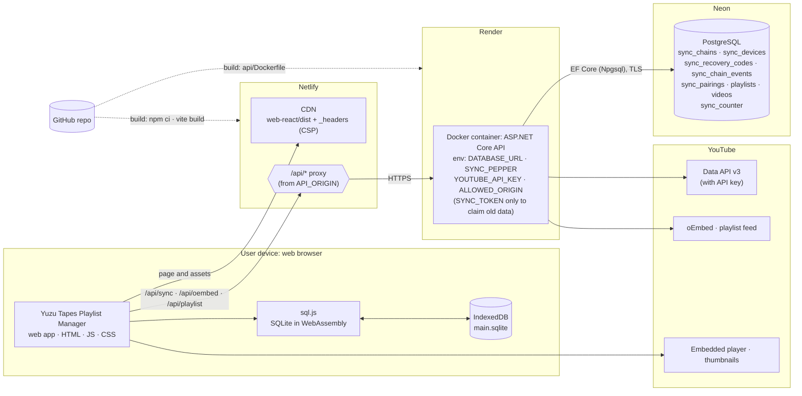

# Architecture

Two views of Yuzu Tapes Playlist Manager: how the code is split into components, and where each part runs once deployed. GitHub renders both diagrams from the Mermaid source below.

## Contents

- [Components](#components)
  - [Web app](#web-app) · [.NET API](#net-api)
- [Deployment](#deployment)
- [Back to the README](../README.md)

## Components

### Web app

The web app runs entirely in the browser. Each domain has the same layers, and calls only go downwards: **components → service → repository or client → core**.

`App.svelte` lays out the shell (playlist drawer and main column) and renders the domain components. Services also call `ui.notify()` to show messages, and `sync.service` reloads the playlists and videos services after pulling changes; those links are left out of the diagram to keep it readable.

### .NET API

One project per layer. Calls go from the API project inwards; Infrastructure implements the interfaces (ports) that Application defines, so the use cases don't depend on EF Core or HTTP. `YtPlaylist.Models` holds the entities and every DTO (the API's requests and responses, and the YouTube responses the clients read), and references no other project (a first step towards the N-tier layout in #26).

| Layer | Where | Responsibility |
| --- | --- | --- |
| Presentation | `web/src/domains/*/components`, `web/src/shared/components` | Svelte views styled with daisyUI; read service state, call service methods |
| Application | `web/src/domains/*/*.service.svelte.js` | Reactive state (`$state`, `$derived`) and use cases such as `videos.addFromText` or `sync.syncNow` |
| Domain rules | `packages/core/src` (TypeScript): `videos/youtube.ts`, `videos/artist.ts`, `playlists/report.ts`, `playlists/report-compare.ts`, `playlists/youtube-sync.ts` | Plain functions with no state or I/O: parsing links, guessing artists, writing and reading reports, comparing a playlist with YouTube. Shared with the React app (#23) |
| Data access | `*.repository.js`, `*.client.js` | Drizzle ORM queries against the local database; HTTP calls to the API |
| Core | `packages/core/src/db`, `web/src/core` | SQLite wrapper (sql.js + Drizzle), table definitions and migrations, and IndexedDB persistence behind a `Persistence` interface, in TypeScript and shared with the React app; the data-changed signal and the API address in `web/src/core` |
| API | `api/src/YtPlaylist.*` | Endpoints and auth (Api), use cases and ports (Application), entities and DTOs (Models), ID rules and limits (Domain), EF Core and YouTube clients (Infrastructure) |

**The recovery hook.** Every way of replacing a chain's code goes through one step, `ChainService.RunRecoveryHookAsync`: recovering with a recovery code, **Generate a new code**, and later the cleanup of abandoned chains. It makes a new secret and new recovery codes, and `IChainStore.ResetAccessAsync` writes everything in one transaction:

1. Locks `sync_counter`, like every sync write, so the hook waits for a sync in progress.
2. Uses the recovery code, if there is one. Two recoveries with the same code can't both win.
3. Sets the new secret hash.
4. Removes every device except the caller, or adds the device that recovered, and cancels every pairing code, so a request approved before can't add a device after.
5. Replaces the recovery codes and writes the audit entry.

A sync checks its device again after taking the same lock, so a device removed by the hook can't write afterwards, even if its request was authenticated just before. #53 will extend the hook: it will delete the connected accounts' tokens in the transaction, and revoke their grants at Google after it's committed.

**Adding a device with a pairing code.** A device in the chain creates a short code; the new device enters it (or scans its QR code); the first device approves; only then does the new device get a credential. `ChainService.Pairing.cs` has the use cases, and `sync_pairings` one row per open code:

* The code is 8 characters of Crockford base32 (40 bits), single use and short-lived, and it only adds a device after a person approves it. Like every secret here, the code and the request token are stored only as HMACs; the new device's credential is created when it collects it, so it's never stored at all.
* Entering a code is one conditional `UPDATE … WHERE status = 'waiting' AND expires_at > now`, so of two devices entering the same code only one gets it. Collecting the credential is the same kind of update, in one transaction with adding the device.
* Only the device that created the code can approve or deny it. A device has one code at a time, and closing the sync settings cancels it. Removing that device, or replacing the chain's code, deletes its pairings.

**Rate limits and lockouts.**

* **Per IP:** ASP.NET rate limiting on every endpoint without a device credential (`chain-secrets` 10/min, `chain-recovery` 5 per 15 min, `chain-pairing` 10 per 15 min, `chain-pairing-status` 60/min), plus a cap for everyone on `/api/chains`. On top of that, `IAttemptLockout` counts wrong codes of any kind (chain code, pairing code, recovery code, request token): 5 within 15 minutes lock the IP out of joining, pairing and recovering for 15 minutes (429 with `Retry-After`).
* **Per chain:** a wrong code can't be tied to a chain, but a refused attempt can: a denied request, or a used code entered again. Three of them within an hour pause pairing for the chain for an hour: its open codes are cancelled, new ones are refused (423), the audit log gets `pairing_locked`, and `GET /api/chain` returns `pairingLockedUntil`, which every device shows as a notice (they reload the chain after a sync at most every 10 minutes). The strikes are counted from the audit log, in the same transaction as the strike.

**Redis or PostgreSQL.** Decision: PostgreSQL, without Redis. The issue (#15) listed three uses for Redis; none needs it with one API instance:

| Use | With PostgreSQL | Why it's enough |
| --- | --- | --- |
| Short-lived pairing codes | `sync_pairings` with an `expires_at` column, checked in every query; expired rows are deleted when a new code is created | Single use comes from a conditional update, which Redis would need a script for; the rows also back the approval step and the audit log |
| Rate limiting and lockouts | ASP.NET rate limiting and `InMemoryAttemptLockout`, in the API's memory; the per-chain pause in `sync_chains.pairing_locked_until` | One instance sees every request. The per-chain pause has to survive restarts and reach every device, so it belongs in the database anyway. Restarting clears the per-IP counters, which is acceptable on top of codes that can't be guessed |
| Locks around replacing a code and syncing | The `sync_counter` row lock (`SyncCounterLock`) in the same transaction as the writes | The database is the final check either way (a lock in Redis can expire during a pause); one lock for every chain is fine at this size |

If the API ever runs on more than one instance, the per-IP counters move behind `IAttemptLockout` to a shared store (e.g. Render's Key Value, which is Redis-compatible), and the global `sync_counter` lock can become a per-chain row lock or advisory lock in PostgreSQL. Redis stays optional: the API runs, locally and in tests, without it.

## Deployment

Netlify serves the static web app and forwards `/api` to the .NET API, which runs as a Docker container on Render. Data lives in two places: each browser's local SQLite database, and the PostgreSQL database on Neon that keeps devices in sync.

Not shown: the browser also loads Google Fonts, and falls back to noembed.com for video titles when the API can't be reached.

| Node | What runs there | Notes |
| --- | --- | --- |
| User device | The web app, SQLite (sql.js) and IndexedDB | Works offline; every browser keeps its own copy of the data |
| Netlify CDN | `web-react/dist` with the headers from `web-react/public/_headers` | Content-Security-Policy limits connections to the app's own API and noembed.com |
| Netlify proxy | `/api/*` forwarded to the Render service | Written at build time from `API_ORIGIN`; requests time out after 26 seconds |
| Render | The .NET API in a Docker container (`api/Dockerfile`, `render.yaml`) | Applies EF Core migrations on start; the free plan sleeps when idle |
| Neon | The shared PostgreSQL database | One library per sync chain: playlists and videos are keyed by `chain_id` and ID, so each chain keeps its own copy of a row even when another chain has the same ID, and a device only reads and writes its own chain's rows. Chain codes, recovery codes, pairing codes and device credentials are stored only as HMACs keyed with `SYNC_PEPPER`; each chain has an audit log without secrets. Last-write-wins sync; each row has a `seq` the clients use as a cursor. It pauses when idle and closes its connections, and the API retries on a new one |
| YouTube | oEmbed, Data API v3, playlist feed, thumbnails, embedded player | The Data API is only used when `YOUTUBE_API_KEY` is set; it reads whole playlists, including their deleted and private videos. The embedded player loads in the browser and doesn't use the key |

For local development the same pieces run on one machine: `npm run dev` (Vite, which proxies `/api`), `dotnet run --project src/YtPlaylist.Api` on port 8787, and PostgreSQL from `docker compose up` in `api/`. See the README.
