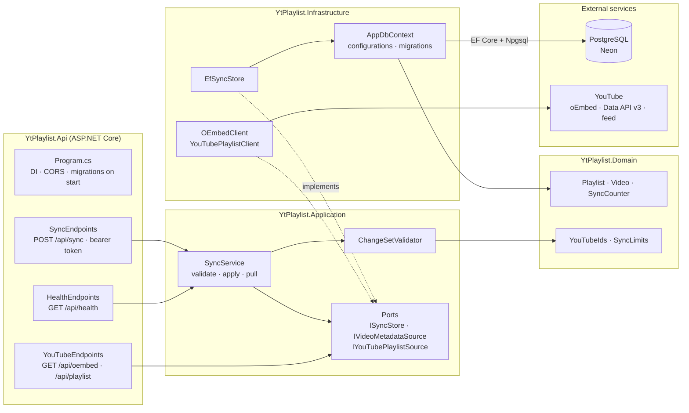
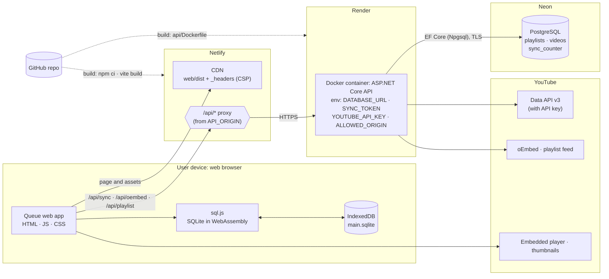

# Architecture

Two views of Queue: how the code is split into components, and where each part runs once deployed. GitHub renders both diagrams from the Mermaid source below.

## Components

### Web app

The web app runs entirely in the browser. Each domain has the same layers, and calls only go downwards: **components → service → repository or client → core**.

`App.svelte` lays out the shell (playlist drawer and main column) and renders the domain components. Services also call `ui.notify()` to show messages, and `sync.service` reloads the playlists and videos services after pulling changes; those links are left out of the diagram to keep it readable.

### .NET API

One project per layer. Calls go from the API project inwards; Infrastructure implements the interfaces (ports) that Application defines, so the use cases don't depend on EF Core or HTTP.

| Layer | Where | Responsibility |
| --- | --- | --- |
| Presentation | `web/src/domains/*/components`, `web/src/shared/components` | Svelte views styled with daisyUI; read service state, call service methods |
| Application | `web/src/domains/*/*.service.svelte.js` | Reactive state (`$state`, `$derived`) and use cases such as `videos.addFromText` or `sync.syncNow` |
| Data access | `*.repository.js`, `*.client.js` | SQL against the local database; HTTP calls to the API |
| Core | `web/src/core` | SQLite wrapper and persistence, the data-changed signal, the API address |
| API | `api/src/YtPlaylist.*` | Endpoints and auth (Api), use cases and ports (Application), entities and rules (Domain), EF Core and YouTube clients (Infrastructure) |

## Deployment

Netlify serves the static web app and forwards `/api` to the .NET API, which runs as a Docker container on Render. Data lives in two places: each browser's local SQLite database, and the PostgreSQL database on Neon that keeps devices in sync.

Not shown: the browser also loads Google Fonts, and falls back to noembed.com for video titles when the API can't be reached.

| Node | What runs there | Notes |
| --- | --- | --- |
| User device | The web app, SQLite (sql.js) and IndexedDB | Works offline; every browser keeps its own copy of the data |
| Netlify CDN | `web/dist` with the headers from `web/public/_headers` | Content-Security-Policy limits connections to the app's own API and noembed.com |
| Netlify proxy | `/api/*` forwarded to the Render service | Written at build time from `API_ORIGIN`; requests time out after 26 seconds |
| Render | The .NET API in a Docker container (`api/Dockerfile`, `render.yaml`) | Applies EF Core migrations on start; the free plan sleeps when idle |
| Neon | The shared PostgreSQL database | Last-write-wins sync; each row has a `seq` the clients use as a cursor |
| YouTube | oEmbed, Data API v3, playlist feed, thumbnails, embedded player | The Data API is only used when `YOUTUBE_API_KEY` is set |

For local development the same pieces run on one machine: `npm run dev` (Vite, which proxies `/api`), `dotnet run --project src/YtPlaylist.Api` on port 8787, and PostgreSQL from `docker compose up` in `api/`. See the README.
