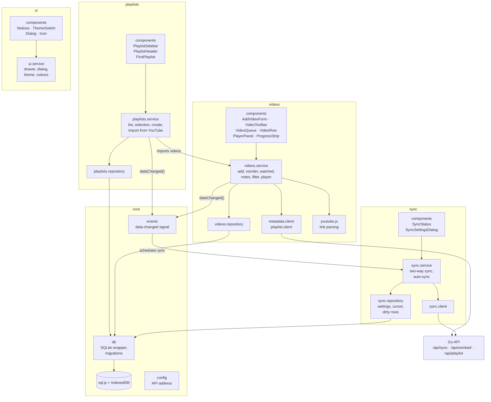
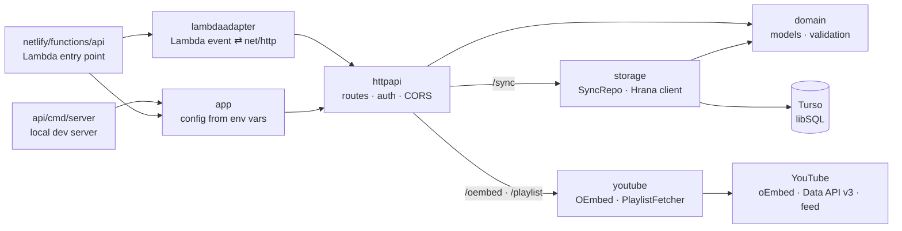
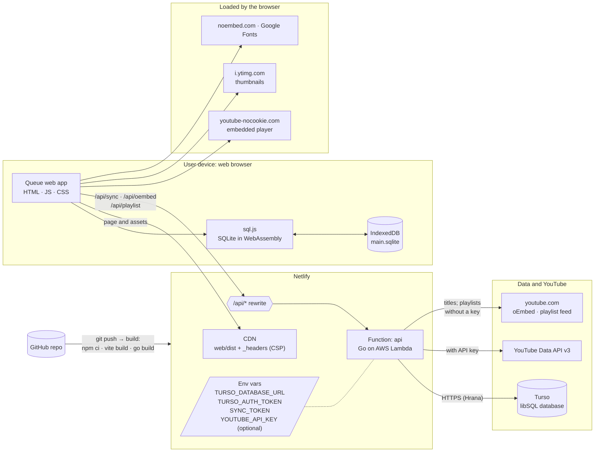

# Architecture

Two views of Queue: how the code is split into components, and where each part runs once deployed. GitHub renders both diagrams from the Mermaid source below.

## Components

### Web app

The web app runs entirely in the browser. Each domain has the same layers, and calls only go downwards: **components → service → repository or client → core**.

`App.svelte` lays out the shell (playlist drawer and main column) and renders the domain components. Services also call `ui.notify()` to show messages, and `sync.service` reloads the playlists and videos services after pulling changes; those links are left out of the diagram to keep it readable.

### Go API

| Layer | Where | Responsibility |
| --- | --- | --- |
| Presentation | `web/src/domains/*/components`, `web/src/shared/components` | Svelte views styled with daisyUI; read service state, call service methods |
| Application | `web/src/domains/*/*.service.svelte.js` | Reactive state (`$state`, `$derived`) and use cases such as `videos.addFromText` or `sync.syncNow` |
| Data access | `*.repository.js`, `*.client.js` | SQL against the local database; HTTP calls to the Go API |
| Core | `web/src/core` | SQLite wrapper and persistence, the data-changed signal, the API address |
| Go API | `api/*`, `netlify/functions/api` | Routes and auth, the Turso sync store, YouTube lookups, the shared data model |

## Deployment

One Netlify site serves the static web app and runs the Go API as a function. Data lives in two places: each browser's local SQLite database, and the Turso database that keeps devices in sync.

| Node | What runs there | Notes |
| --- | --- | --- |
| User device | The web app, SQLite (sql.js) and IndexedDB | Works offline; every browser keeps its own copy of the data |
| Netlify CDN | `web/dist` with the headers from `web/public/_headers` | Content-Security-Policy limits connections to the app's own API and noembed.com |
| Netlify Function | The Go API (`netlify/functions/api`) | Built from source on each deploy; configured by environment variables |
| Turso | The shared libSQL database | Last-write-wins sync; each row has a `seq` the clients use as a cursor |
| YouTube | oEmbed, Data API v3, playlist feed, thumbnails, embedded player | The Data API is only used when `YOUTUBE_API_KEY` is set |

For local development the same pieces run on one machine: `npm run dev` (Vite, which proxies `/api`), `go run ./api/cmd/server` on port 8787, and `turso dev` as the database. See the README.
